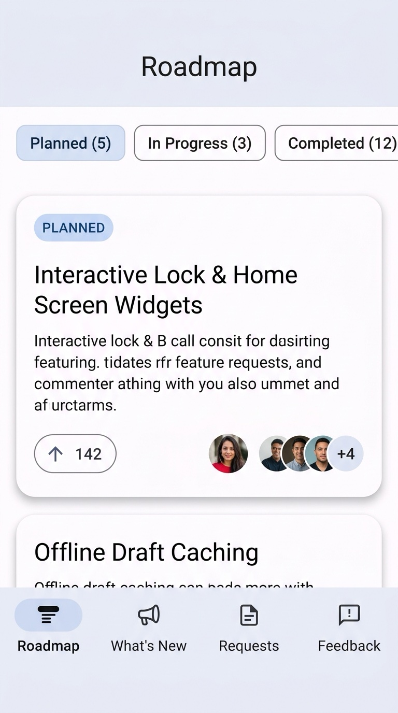
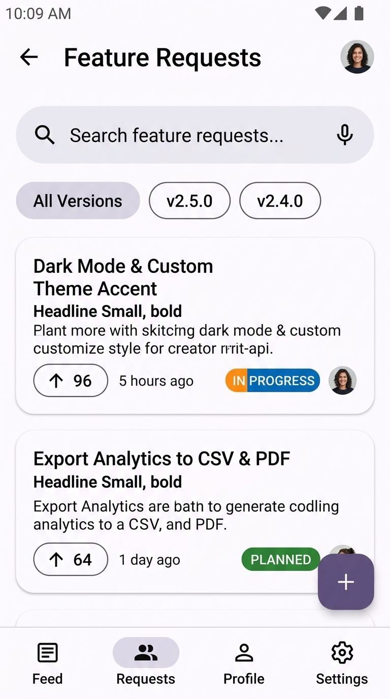
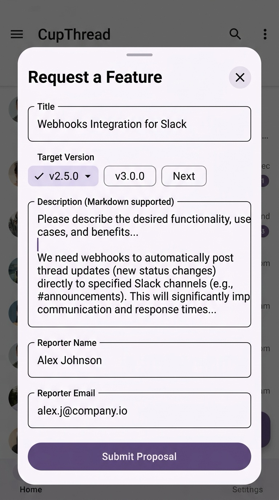
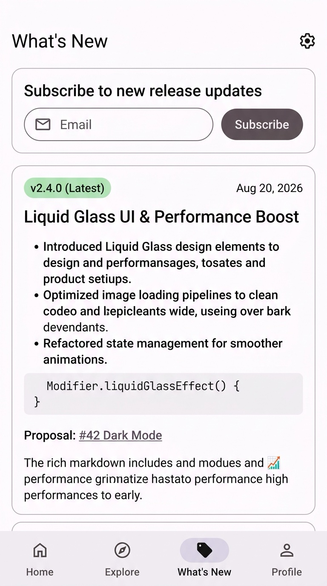
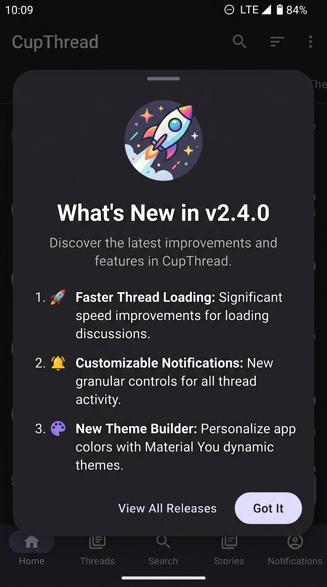
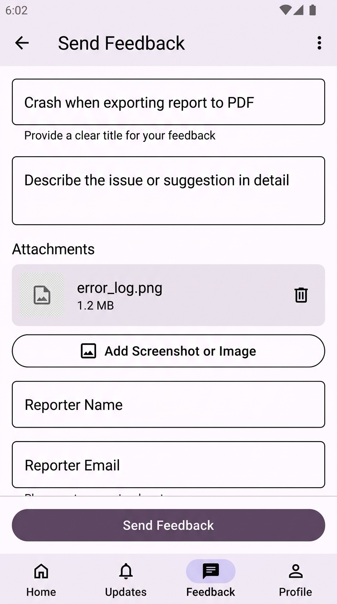

# CupThread Android SDK

Native Kotlin + Jetpack Compose SDK for Android 8+ (minSdk 26, Material 3).

Part of the [CupThread.com](https://cupthread.com) platform.

## Visual Showcase

| **Roadmap Board** | **Feature Requests** | **Submit Request** |
| :---: | :---: | :---: |
|  |  |  |
| Kanban columns, stage chips & vote counts | Optimistic voting, search & version filter | User request compose sheet |

| **What's New / Changelog** | **Changelog Overlay** | **Feedback Composer** |
| :---: | :---: | :---: |
|  |  |  |
| Markdown release notes & email subscribe | In-app What's-New sheet with seen tracking | Structured feedback with auto metadata |

---

## 🤖 Recommended: Install via AI Agent (Agentic Coding)

Instead of manually editing Gradle build files and writing boilerplate by hand, install the official **CupThread Android AI Skill** into your workspace with [`npx skills`](https://github.com/skills-directory/skills) and let your AI assistant (Claude Code, Cursor, Copilot, Android Studio, Windsurf, Codex, Antigravity) integrate and customize it for you:

```sh
npx skills add CupThread/CupThreadAgenticCoding --skill cupthread-android-sdk
```

Once installed, simply copy and paste this prompt to your AI coding agent:

```text
Integrate the CupThread Android SDK (roadmap, changelog, and feedback screens) into this Compose app. Scaffold a dedicated configuration helper with a placeholder for the App Key, and at the end, remind me with step-by-step instructions on how to set my App Key safely (e.g. via local.properties).
```

---

## CupThread Ecosystem
- 🌐 [CupThread.com](https://cupthread.com) — Feedback SaaS platform, developer console, and API.
- 🍏 [CupThread/CupThreadSwiftSDK](https://github.com/CupThread/CupThreadSwiftSDK) — Apple platform SDK (SwiftUI / SPM / XCFramework).
- 🤖 [CupThread/CupThreadAndroidSDK](https://github.com/CupThread/CupThreadAndroidSDK) — Android SDK (Jetpack Compose / Maven).
- ⚛️ [CupThread/CupThreadReactNativeSDK](https://github.com/CupThread/CupThreadReactNativeSDK) — React Native & Expo SDK (TypeScript).
- 💙 [CupThread/CupThreadFlutterSDK](https://github.com/CupThread/CupThreadFlutterSDK) — Flutter SDK (Dart).
- 🧠 [CupThread/CupThreadAgenticCoding](https://github.com/CupThread/CupThreadAgenticCoding) — AI-friendly CLI & Skills for pair programming.

---

## Manual Installation

Add the CupThread Maven repository and the dependency:

```kotlin
// settings.gradle.kts (or root build.gradle.kts)
dependencyResolutionManagement {
    repositories {
        google()
        mavenCentral()
        maven {
            name = "CupThreadCDN"
            url = uri("https://cdn.cupthread.com/maven")
        }
    }
}

// app/build.gradle.kts
dependencies {
    implementation("dev.cupthread:feedback:0.1.0")
}
```

---

## Quick Start

```kotlin
val client = FeedbackClient(
    FeedbackClientConfig(
        baseUrl = "https://api.cupthread.com",
        appKey = "app_xxx" // from the developer console
    )
)
val userToken = UserTokenStore.create(context).token
```

`FeedbackPlatform.current` is `ANDROID`. The composer pre-fills version name and version code from the host package automatically.

---

## API Reference

The full KDoc-generated API reference is published automatically on every push to `main`:

**[https://cupthread.github.io/CupThreadAndroidSDK/](https://cupthread.github.io/CupThreadAndroidSDK/)**

To generate the docs locally (output in `feedback/build/dokka/html`):

```sh
./gradlew :feedback:dokkaGenerateHtml
```

---

## Ready-Made Compose Screens

Wrap your UI tree in `CupThreadTheme(client)` so console skin settings apply:

- `FeedbackComposer(client, userToken, onSubmit)` / `FeedbackComposerSheet(client, userToken, onDismiss, onSubmit)` — Structured feedback form with attachment uploads and system PhotoPicker.
- `FeatureRequestsScreen(client, userToken)` — Browse, vote (optimistic), and submit requests.
- `RoadmapBoardScreen(client, userToken)` — Column chips + paged lists grouped by public roadmap columns.
- `WhatsNewScreen(client, userToken)` — Changelog list with email subscribe / unsubscribe.
- `ChangelogOverlay(client, visible, onlyIfUnseen, onDismiss)` / `client.presentLatestChangelog(activity, onlyIfUnseen)` — What's-New modal with built-in seen state persistence.

```kotlin
CupThreadTheme(client) {
    RoadmapBoardScreen(client = client, userToken = userToken)
}

// Present latest changelog only if unseen:
lifecycleScope.launch {
    client.presentLatestChangelog(activity, onlyIfUnseen = true)
}
```

---

## API Surface

| Method | Endpoint / Description |
| ------ | ---------------------- |
| `submit(draft, userToken, turnstileToken?)` | `POST /api/v1/feedback` (sends `X-User-Token`) |
| `uploadAttachment(data, filename, mimeType, preferredKind, userToken, turnstileToken?)` | Images: `POST /api/v1/uploads/images` (metadata-scrubbed, see [Image Metadata Privacy](#image-metadata-privacy)); other files: upload sessions (`POST /api/v1/uploads/sessions` + `PUT /api/v1/uploads/{uploadId}`, requires `X-User-Token`) |
| `fetchAppConfig()` | `GET /api/v1/public/config/{appKey}` |
| `prepareChangelogOverlay(context, onlyIfUnseen)` | Config + newest changelog entries with seen filtering |
| `presentLatestChangelog(activity, onlyIfUnseen)` | Presents overlay sheet with automatic seen persistence |
| `fetchFeatureRequests(userToken, limit, offset, versionId, query, cursor)` | `GET /api/v1/feature-requests` (returns `hasMore` / `nextCursor`) |
| `submitFeatureRequest(draft, userToken, turnstileToken?)` | `POST /api/v1/feature-requests` |
| `toggleVote(featureRequestId, userToken, turnstileToken?, shipNotifyEmail?)` | `POST /api/v1/feature-requests/{id}/vote` |
| `fetchComments(featureRequestId)` | `GET /api/v1/feature-requests/{id}/comments` (auto-paginating) |
| `fetchCommentsPage(featureRequestId, limit, cursor)` | `GET /api/v1/feature-requests/{id}/comments` (returns `hasMore` / `nextCursor`) |
| `postComment(featureRequestId, draft, userToken)` | `POST /api/v1/feature-requests/{id}/comments` |
| `fetchUserProfile(userId)` | `GET /api/v1/users/{userId}/profile?appKey={appKey}` |
| `fetchColumns()` | `GET /api/v1/public/columns/{appKey}` |
| `fetchVersions()` | `GET /api/v1/public/versions/{appKey}` |
| `fetchChangelog()` | `GET /api/v1/public/apps/{appKey}/changelog` |
| `subscribeToChangelog(email, userToken, turnstileToken?)` | `POST /api/v1/public/apps/{appKey}/changelog/subscribe` |
| `unsubscribeFromChangelog(email)` | `POST /api/v1/public/apps/{appKey}/changelog/unsubscribe` |
| `updateUserAttributes(userToken, isPaying, plan, mrr, currency)` | `PUT /api/v1/public/apps/{appKey}/user` |
| `ChangelogStore.create(context)` | Persistent store for tracking seen changelog versions |

### Signed User Attributes (isPaying / plan / mrr / currency)

The server rejects `PUT /api/v1/public/apps/{appKey}/user` calls that carry any payment attribute
(`isPaying`, `plan`, `mrr`) or `currency` unless they are HMAC-SHA256 signed
(`422 payment_attributes_require_signature`). Pass your app's SDK signing secret from the console
(*App Access → App Credentials → SDK signing secret*) via `FeedbackClientConfig.sdkSigningSecret`
and the SDK signs those calls automatically (the `cpt-user-attrs-v1` canonical string plus
`signature` + `timestamp` on the body). Calls without signed attributes stay unsigned:

```kotlin
val config = FeedbackClientConfig(
    baseUrl = "https://api.cupthread.com",
    appKey = "app_xxx",
    sdkSigningSecret = BuildConfig.CUPTHREAD_SDK_SIGNING_SECRET
)
```

### Paging

`FeatureRequestsScreen` and `RoadmapBoardScreen` load further pages as the user scrolls, so boards
with more than 50 requests show every item and column counts include the whole board. Search and
version filter changes restart paging from the first page. For custom surfaces,
`fetchFeatureRequests` returns `hasMore` / `nextCursor`; pass `nextCursor` back as `cursor`
(keyset paging) or advance `offset` by the number of returned requests.

### Request Correlation (X-Request-Id)

Every API call carries an `X-Request-Id` request header — a fresh UUID by default — and the
server's echoed identifier is attached to thrown `FeedbackException`s as `requestId`, so it can be
quoted in support conversations to locate the exact request in CupThread server logs. To correlate
SDK traffic with your own tracing, supply a factory on the config:

```kotlin
val client = FeedbackClient(
    FeedbackClientConfig(
        baseUrl = "https://api.cupthread.com",
        appKey = "app_xxx",
        requestIdProvider = { tracer.currentTraceId() } // returning null/blank/invalid skips the header
    )
)

try {
    client.submit(draft, userToken)
} catch (e: FeedbackException.UnexpectedStatus) {
    Log.e("Feedback", "Submit failed (${e.code}); request id: ${e.requestId}")
}
```

The server honors values matching `^[A-Za-z0-9._-]{8,64}$` and replaces anything else with its own
generated identifier.

### Human Verification (Turnstile)

Production deployments with Turnstile enforcement reject the gated intake calls — `submit`
(`POST /api/v1/feedback`), `submitFeatureRequest` (`POST /api/v1/feature-requests`), and
non-image `uploadAttachment` (upload-session creation) — with HTTP 403 unless the request
carries a valid Cloudflare `turnstileToken`. Install a `TurnstileTokenProvider` on the config so
submissions succeed:

```kotlin
val client = FeedbackClient(
    FeedbackClientConfig(
        baseUrl = "https://api.cupthread.com",
        appKey = "app_xxx",
        turnstileTokenProvider = TurnstileTokenProvider { challenge ->
            // Mint a FRESH single-use token per invocation under the exact (action, cdata)
            // binding the endpoint validates — e.g. render the Cloudflare widget with
            // action = challenge.action ("feedback" or "feature-request") and
            // cdata = challenge.cdata (your app key), or server-mint one.
            myTurnstileBridge.solve(challenge.action, challenge.cdata)
        }
    )
)
```

Provider contract:

- `token(challenge)` is consulted at most twice per gated call: once before the first attempt and
  once more only if the server rejects it with a retryable `turnstile_*` 403 — the SDK then
  resends exactly once with the fresh token. Returning `null` (or throwing) sends the request
  unverified, which the server answers with a typed `FeedbackException.VerificationRequired`
  (carrying `serverCode`: `turnstile_required`, `turnstile_verification_failed`, or
  `turnstile_not_configured`) instead of a raw JSON error body.
- Explicit `turnstileToken` parameters on `submit`, `submitFeatureRequest`, and
  `uploadAttachment` take precedence for the first attempt; the provider is still consulted for
  a retry.
- Bindings: feedback intake and upload-session creation share action `feedback`; feature-request
  submission uses `feature-request`; in both cases `cdata` is your app key
  (`TurnstileChallenge.feedback(appKey)` / `TurnstileChallenge.featureRequest(appKey)`).

The built-in `FeedbackComposer` and feature-request compose sheet surface a localized
verification message when a submission is rejected by the gate.

Tip: `PublicAppConfig.turnstile?.siteKey` (from `fetchAppConfig`) publishes the public widget site
key when the deployment supports WebView challenges. Native clients can mint tokens by loading
`https://app.cupthread.com/turnstile/verify?siteKey=…&action=…&cdata=…&theme=light|dark|auto&locale=…`
in an embedded WebView and reading the `{status:"success", token}` message posted to
`window.AndroidTurnstileBridge.postMessage(JSON)` (`@JavascriptInterface`). Tokens are single-use
with a ~300 s validity window — mint a fresh one per call.

### Image Metadata Privacy

`uploadAttachment` scrubs every image payload before it leaves the device, because CupThread
attachments end up on publicly readable CDN URLs:

- **JPEG**: the EXIF GPS Info IFD is zeroed in place, so location coordinates become
  unrecoverable while display-relevant tags (orientation, color space) survive. APP1 XMP,
  APP13 (IPTC/Photoshop), COM comments and unknown APPn metadata segments are dropped;
  APP0 (JFIF), APP1 (EXIF), APP2 (ICC color profile) and APP14 (Adobe transform flag) are kept.
  Marker segments between entropy-coded scans (progressive JPEGs) are scrubbed too.
- **PNG**: `eXIf`, `tEXt`, `iTXt`, `zTXt` and `tIME` chunks are dropped.
- **WebP**: `EXIF` and `XMP` chunks (fourcc `XMP` with a trailing space) are dropped.
- **GIF**: Comment Extensions and `XMP Data` Application Extensions are dropped; animation
  extensions such as `NETSCAPE2.0` are kept.
- Non-image attachments (logs, crashes, text) are never touched.

Scrubbing is lossless (pixel data is never re-encoded) and always on — there is no host opt-out,
and it applies no matter which storage backend an image is routed to (including explicit
`preferredKind` overrides). If a metadata structure is malformed beyond confident parsing, the
whole structure is dropped rather than uploaded (fail closed). If the file structure of a
recognized image is itself corrupt, the upload is rejected locally with
`FeedbackException.UnsupportedMediaType` — bytes that cannot be parsed cannot be promised
metadata-free. Content appended after the image's end marker (JPEG EOI, PNG IEND, GIF trailer) —
e.g. motion-photo video, which can carry its own GPS track — is dropped as well: only bytes the
scrubber parsed and vouched for are uploaded.

Known limitations to be aware of:

- **Only the GPS IFD is removed from EXIF.** Other EXIF fields survive by design, because
  removing them requires rewriting the TIFF layout and would lose orientation (rotating photos
  incorrectly). Camera make/model, capture timestamps, exposure settings and serial numbers, if
  present, are still uploaded — hosts with stricter needs should re-encode images themselves
  before calling `uploadAttachment`.
- Maker-notes are left as-is; they do not carry GPS coordinates on mainstream phone cameras, but
  exotic sources (e.g. some dashcams) may embed non-standard data there.

---

## Development & Testing

```sh
# Run unit tests
./gradlew :feedback:testDebugUnitTest

# Assemble demo app
./gradlew :demo:assembleDebug

# Release a new version (publishes Maven layout, computes sha256, tags & creates release)
node scripts/release.mjs --version 0.1.1
```

## License
MIT
